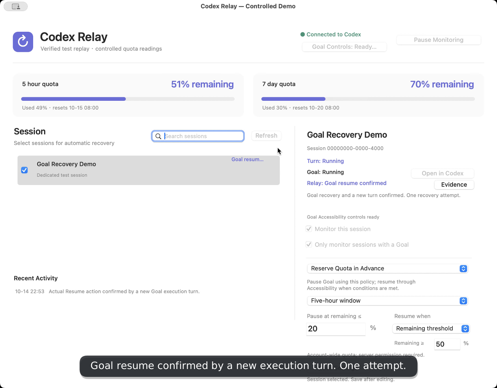

# Codex Relay

**Quota-aware pause and recovery for Codex sessions and Goals.**

A native macOS dashboard and menu bar companion built with Codex. Select the sessions you want Relay to monitor, reserve quota when needed, and resume interrupted work when recovery conditions are met.

Independent community project by [Ian](https://github.com/Ian688). Not affiliated with or endorsed by OpenAI. Relay respects account limits; it does not bypass them.

[简体中文](README.zh-CN.md) · [Quick start](docs/QUICKSTART.md) · [Validation](docs/VALIDATION.md) · [Architecture](docs/ARCHITECTURE.md) · [Polling and diagnostics](docs/POLLING_AND_DIAGNOSTICS.md) · [Adaptive scheduling](docs/ADAPTIVE_SCHEDULING.md)



[Watch the 52-second English demo](https://github.com/Ian688/codex-relay/releases/download/v0.6.0/codex-relay-demo-en.webm) — a labeled replay of a verified real Goal control test, with controlled quota readings.

## What it does

- **Resume after quota exhaustion:** wait for the service to permit usage and your recovery policy to be satisfied.
- **Reserve quota in advance:** pause when account-wide remaining quota reaches a threshold; resume after a reset or a higher remaining-quota threshold.
- **Ordinary sessions:** send a continuation message and confirm a new turn.
- **Goals:** optionally use macOS Accessibility to verify and operate the real Goal Resume button, then confirm execution with the Desktop owner. Sending “Continue” alone is not Goal recovery.
- **Explain decisions:** show turn, Goal, and Relay state separately, with timestamps and read-only evidence.
- **Prevent duplicate recovery:** bind actions to an interruption episode and stop automatic retries after uncertain submission.

Manual Goal pauses remain manual. Completed tasks do not restart indefinitely. Relay never creates or deletes production Goals automatically.

## Run on macOS

Requirements: Python 3.11+, Xcode Command Line Tools to build, a logged-in Codex Desktop installation at `/Applications/ChatGPT.app`, and Codex CLI available on PATH. No API key or third-party Python dependencies are needed.

```sh
git clone https://github.com/Ian688/codex-relay.git
cd codex-relay
python3 scripts/build_macos.py
open 'dist/Codex Relay 0.7.0.app'
```

Build on the Mac where you will run the app. The bundle uses your installed Python and Codex; it is not a self-contained universal installer. Locally ad-hoc signed, not Apple-notarized.

1. Select a session in Relay.
2. Choose and save its quota policy.
3. For Goal control, explicitly enable **Goal Controls** and grant Accessibility permission when macOS requests it.
4. Click **Start Monitoring**. Selecting a session does not start monitoring.

English is the default display language. Choose **Language / 语言 → 简体中文** for Chinese; quit and reopen to apply. Save edits before quitting. Closing the dashboard keeps monitoring in the menu bar; quitting stops monitoring, while Codex tasks continue independently.

## Polling and diagnostics

Use **Codex Relay → Monitoring Settings…** to change normal checks (default 30s), dashboard refresh (60s), and idle quota-wait checks (300s). Saved changes apply without restarting Python. Each session has its own schedule. Reserve pauses wait even when quota is usable. Automatic UI refresh uses local monitor data only; Manual Refresh forces reads and wakes eligibility checks. Disable **Check for early quota resets** to sleep until a known reset deadline. Remaining-threshold policies and unknown deadlines still require periodic probes. Connection failures back off. See [details and log locations](docs/POLLING_AND_DIAGNOSTICS.md).

[Scheduler interface preview](docs/images/scheduler.png) (test data).

## Validation and limits

A dedicated Goal has completed a real native pause → Accessibility recovery → new-turn confirmation sequence. Quota trigger readings were controlled in an isolated test database; the test did **not** exhaust account quota or wait through an entire reset window. See [validation details](docs/VALIDATION.md).

The current adapter was tested on an Intel Mac and Codex Desktop 26.1007.30912/build 20156, with English and Chinese Goal labels. Other installations, versions, languages, or layouts may be rejected. Desktop IPC and Accessibility integration are version-sensitive.

Recovery requires Relay and Codex to remain running and the Mac awake. Goal recovery can bring Codex to the foreground. Permission loss, changed targets, pending user input, or ambiguous controls stop the action. Account quota is shared with other sessions, and service readings may lag. A reset timestamp alone is not proof that execution is allowed.

## Development

```sh
python3 -m unittest discover -s tests -v
python3 scripts/build_macos.py
'dist/Codex Relay 0.7.0.app/Contents/MacOS/CodexRelay' --language en --ui-test /tmp/relay-ui-en.json
'dist/Codex Relay 0.7.0.app/Contents/MacOS/CodexRelay' --language zh --ui-test /tmp/relay-ui-zh.json
```

The native AppKit UI communicates with the Python policy engine over stdin/stdout, with no HTTP listener. Accessibility control is opt-in. User content and raw evidence are preserved in their original language; interface translation does not alter actions or state.

## Contribute

Issues with reproduction steps, sanitized screenshots, or design suggestions are welcome. Never attach your state database, credentials, or private conversation logs. See [security guidance](SECURITY.md).

MIT licensed. See [LICENSE](LICENSE).
